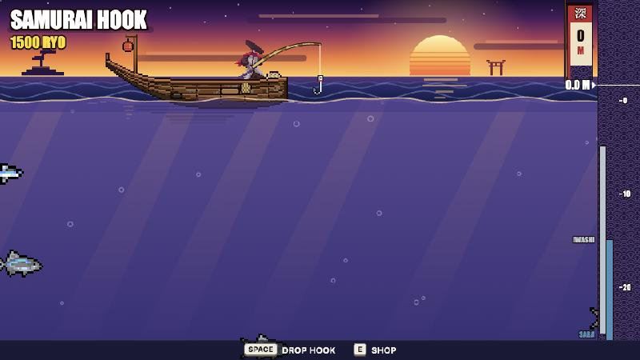
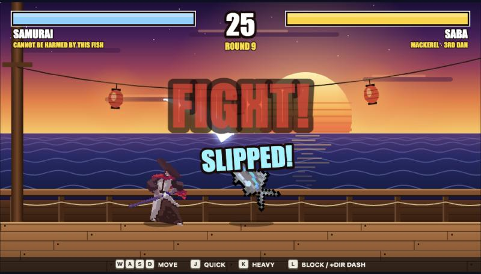
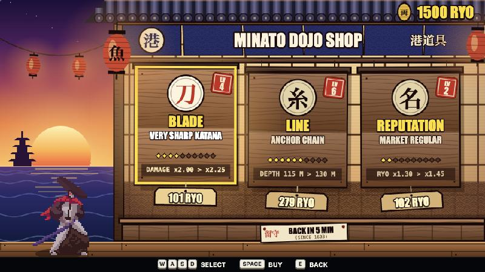

# SamuraiHook: nobody reels in a fish without a fight

Fish are slippery, so you can't just reel one in. The moment your hook touches a fish, it challenges you to a duel, and a very serious samurai has to win it before the timer runs out. Win, and the fish becomes nigiri.

Sell the catch, sharpen the katana, drop the line deeper, and meet bigger, angrier fish. A round takes under a minute.

**Play in your browser:** https://yurtemre7.github.io/samurai-hook/
**On itch.io:** https://yurtemre7.itch.io/samurai-hook
([Start with some progress](https://yurtemre7.github.io/samurai-hook/?start=demo) if you want to see the deeper fish.)

It works with a keyboard or a gamepad, and your progress is saved in the browser.

| Fishing | Duel | Shop |
|---|---|---|
|  |  |  |

## How it plays

1. Drop the hook and steer it. Touching any fish starts a duel, so steer past the small fry to reach the valuable fish deeper down.
2. Win before the timer runs out. Slippery fish dodge your next strike when they are ready to slip, then are briefly helpless. Bait the slip with a quick slash, then land heavy slashes.
3. Some fish bite. Watch for the wind-up, then block or dash.
4. Beaten fish are sold automatically for ryo. In the shop, spend it on a better blade, a longer line, or a better reputation (more ryo per fish). Each of the three tracks has no end, and prices rise.
5. Below 170 m the roster repeats in tougher, richer tiers (Elder, Sensei, Shogun, Yokai, Kami).

Duels are staged like a fighting game: health bars, a round timer, quick and heavy slashes, block and dash-dodge, hit-stop, screen shake and an announcer ("ROUND ONE!", "FIGHT!"). The announcer is a set of recorded clips run through audio effects, with browser speech synthesis as the fallback.

It is a small single-player 2D game built with TypeScript, Vite and Canvas 2D, without a game engine.

## The fish

| Fish | Species | Type | Depth | Special |
|---|---|---|---|---|
| Iwashi | Sardine | slippery | 5-25 m | the tutorial fish |
| Saba | Mackerel | slippery | 15-40 m | weaves |
| Pirania | Piranha | biter | 30-55 m | fast, weak bites |
| Unagi | Eel | slippery | 40-70 m | slips almost everything |
| Fugu | Pufferfish | slippery | 55-90 m | inflates and bounces you back |
| Kajiki | Swordfish | biter | 75-110 m | long fencing lunges |
| Anko | Anglerfish | slippery | 95-130 m | fights in the dark |
| Hojiro | Great white shark | biter | 115-150 m | slow, very heavy bite |
| Daioika | Giant squid | slippery | 140-170 m | squirts ink over the screen |

## Controls

Keyboard and gamepad both work at any time. The prompts at the bottom of the screen switch to whichever you used last.

| Action | Keyboard | Gamepad |
|---|---|---|
| Move / steer the hook | A D or arrow keys (W S or up/down to brake / sink faster) | left stick or d-pad |
| Confirm, drop hook, skip | Space or Enter | A |
| Quick slash | J | X |
| Heavy slash | K | Y |
| Defend: hold to block, tap with a direction to dash-dodge | L or Shift | B or RB |
| Shop (at the surface) | E | Y |
| Shop: choose an upgrade | A D or left/right arrows | left stick or d-pad |

### Demo shortcuts

| Shortcut | What it does |
|---|---|
| F2, or open the page with `?start=demo` | Start with progress: 1500 ryo, blade level 4, line level 6 (115 m), reputation level 2. Change the preset in `demoStart` in `src/manifest.ts`. |
| F4, or `?start=fresh` | Wipe the save and start over. |

## Run it

Needs Node 20 or newer.

```bash
npm install
```

```bash
npm run dev
```

Then open http://localhost:5173.

| Command | What it does |
|---|---|
| `npm run typecheck` | TypeScript check |
| `npm test` | Unit tests (fight logic, economy, input); also prints a balance table |
| `npm run build` | Production build into `dist/` |

Jump straight to a scene while developing: `http://localhost:5173/?scene=fight&fish=shark&tier=0` (`scene` is one of ocean, cutscene, fight, result, shop). `game` is available in the browser console, for example `game.state.reset()`. Add `?debug=keys` to see which action each key press maps to.

## Change the game without touching game logic

All art, sound, text and tuning live in one file: [src/manifest.ts](src/manifest.ts).

### Rebalance a fish

Edit its entry in the `fish` array: `hp`, `timer`, `gold`, the depth band (`depthMin`, `depthMax`), movement, `slip.recovery` (how long it stays helpless after slipping) and, for biters, `attack`.

### Add a fish

1. Add a sprite entry to `sprites`, for example `'fish.tuna'`. With `src: null` the game draws a labelled placeholder, so art can come later.
2. Add an entry to the `fish` array with a unique `id`, `sprite: 'fish.tuna'`, a depth band, stats and a few `taunts`. Leave out `attack` for a slippery fish; add it for a biter.

The ocean, the fight, the announcer and the depth gauge pick it up from the manifest. Run `npm test` afterwards; one test checks that every depth has at least one fish.

### Swap a sprite

1. Put the image in `public/assets/...`.
2. Point the sprite's `src` at it (path relative to `public/`), set `w` and `h` (draw size in game pixels on the 960x540 canvas) and `facing` (which way the art faces). For an animation, use a horizontal strip of equal-width frames and set `frames` and `fps`.
3. Add a row to CREDITS.md with the source URL, author and licence. Only CC0, public domain or CC-BY assets are accepted.

### Swap a sound or the music

Same idea in `sounds` and `music`: set `src` and `volume`. A sound with `src: null` plays a synthesised blip. The announcer plays recorded clips through an effect chain (`voice.clips`, `voice.presets`, per-line `voice.linePresets`). Browser speech synthesis is the fallback when a clip is missing or fails, and it says "Upgrade!" in the shop. Turn the voice off or change the fallback pitch in `voice`.

### Prices and scaling

`upgrades` holds each shop track's base cost, growth factor, effect per level and level names. `tiers` controls how the roster repeats, tougher and richer, below the deepest fish. `samurai`, `fight` and `ocean` hold the remaining tuning numbers.

## Code layout

```
src/
  main.ts        boot, game loop, scene switching
  manifest.ts    all art, sound, text and tuning
  types.ts       shared contracts between modules
  core/          asset loading and drawing, audio
  input/         keyboard + gamepad actions, prompt glyphs
  game/          gold, upgrades, fish scaling, saving
  fight/         pure fight simulation (no drawing), fish behaviour
  scenes/        ocean, cutscene, fight, result, shop
  ui/            HUD drawing helpers
tests/           unit tests
```

Project documents:

- [HANDOVER.md](HANDOVER.md): current status, open tasks, decisions and known issues. Read it before starting any work.
- [docs/DESIGN.md](docs/DESIGN.md): the game design and architecture.
- [CREDITS.md](CREDITS.md): every asset with its source, author and licence.

## Deployment

Every push to `main` runs the tests, builds, and publishes to GitHub Pages (the `gh-pages` branch) through `.github/workflows/pages.yml`. Every pull request is tested and built too, and a bot comments a play link on it (`https://yurtemre7.github.io/samurai-hook/pr-preview/pr-<number>/`). The preview is removed when the PR closes, and PRs from forks are skipped. The build uses a relative base path, so it works under `/<repo>/` or at a domain root.

## Known gaps

- The squid sprite is a friendly stand-in.
- Four sounds (bite, lose, hook-up, shop "denied") are synthesised blips.
- Kanji use a bundled, subset OFL font (`fonts.kanji` in `src/manifest.ts`; see `tools/README-fonts.md`), falling back to the system's Japanese font.
- Not yet confirmed on a real controller.

See HANDOVER.md for the full list.

## Credits and licence of assets

Most art, sound and music are CC0 or CC-BY from OpenGameArt and itch.io authors, including LuizMelo ("Martial Hero", the samurai). The swordfish, the anglerfish and the nigiri are original pixel art made for this game. The announcer's lines are from Kenney's Voiceover Pack: Fighter (CC0), except "Fight", which is by Alba MacKenna (CC-BY 4.0). Every file is listed with its source and licence in [CREDITS.md](CREDITS.md).

Built at a hackathon by Team 1, with Claude Code.

## Contributing

Read HANDOVER.md first. Work on a short-lived branch, keep commits small, open a pull request against `main`, and update HANDOVER.md in the same commit as the work.
